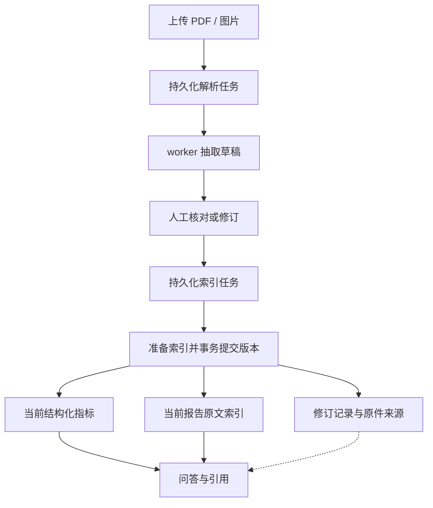

# 健康报告智能检索问答

[](https://github.com/Nancy1022-cloud/health-report-qa/actions/workflows/health-m13.yml)

家庭成员的报告分散在 PDF 和图片中，查询一个指标往往需要翻找多份原件；抽取内容经过人工纠正后，原文、指标和查询索引也需要同步更新。

本项目提供**报告上传、人工核对、指标与原文问答、引用和修订追溯**。工程重点是：重复提交时保持业务记录唯一，处理进程中断后恢复任务，修订后让查询使用有效版本。

**Python 3.12 · FastAPI · Pydantic · PostgreSQL 16 + pgvector · Qwen / OpenAI 兼容接口 · Docker Compose**

当前采用单主机、独立单 worker 部署。已完成综合工程验收与 GitHub CI；在受控索引确认对照中，每组 Embedding 请求从 **400 次降至 100 次**，三个并发档位的任务中位耗时下降 **53.0%–70.6%**。实验条件和完整分母见下文。

## 可以做什么

- **上传并核对报告**：支持 PDF、PNG 和 JPEG，抽取候选文本与指标，人工核对后确认保存。
- **按成员查询资料**：查询结构化指标、对比历史记录，也可检索报告原文；成员和报告范围由服务端约束。
- **回答附带来源**：问答返回指标或片段引用；证据不足时给出明确状态，保留必要的澄清与拒答路径。
- **修订后继续追溯**：保留原始抽取与确认版本，更新当前指标和索引，标记旧来源是否仍有效。
- **查看处理进度**：解析、索引确认和修订通过持久化任务执行，可以查看阶段、尝试次数、错误原因和终态。

## 已验证的结果

记录日期：**2026-10-31**。不同测试的统计单位分别列出。

| 验证内容 | 完成情况 | 统计口径 |
| --- | ---: | --- |
| 自动化测试 | 317 项通过 | unittest 测试方法，覆盖业务、引用、契约、任务与验收门槛 |
| 数据库探针 | 103 个检查项通过 | 覆盖并发确认、回滚、版本、进程中断和旧执行拦截 |
| 受控索引确认负载 | 600 个独立请求 | 并发 1 / 3 / 5，批量大小 1 / 4，每组 100 个请求 |
| 幂等验证 | 100 次重复确认请求 | 与独立处理吞吐分开统计 |
| 真实 Embedding 测量 | 10 个索引任务 | 正式小批次，不含 2 个 pilot 任务；用量由接口 usage 记录 |

[公开汇总](docs/results/m13_public_facts.json) · [已通过的 CI 记录](https://github.com/Nancy1022-cloud/health-report-qa/actions/runs/41214481476) · [CI 工作流](.github/workflows/health-m13.yml)

### 批量索引对照

将同一任务的 Embedding 输入从每次 1 条改为最多 4 条，固定文本、模型配置、数据库、任务预算和 worker 数，比较索引确认任务完成耗时。

| 同时未完成的任务数 | 单条中位耗时 / ms | 批量 4 中位耗时 / ms | 中位耗时下降 | 每组 Embedding 请求数 |
| --- | ---: | ---: | ---: | ---: |
| 1 | 1138.1 | 334.3 | 70.6% | 400 → 100 |
| 3 | 3775.8 | 1257.2 | 66.7% | 400 → 100 |
| 5 | 8065.8 | 3789.3 | 53.0% | 400 → 100 |

每个配置 100 个独立确认请求，共 6 组。各组正确性比较通过。数据见 [CSV](docs/results/m12_comparison.csv)，图表见 [耗时对照](docs/results/m12_latency.svg)。

这组实验使用合成草稿、真实 PostgreSQL / pgvector 和 SDK HTTP；受控接口固定每次响应延迟 20 ms，测试 worker 在独立线程中运行。耗时从提交已准备草稿的确认任务到完成，包含排队与重试；上传解析、问答生成及生产每任务子进程启动开销不在该表范围内。生产子进程联通另有正确性检查。

结果支持批量减少本次场景的请求固定开销。Token 与费用仍按实际 usage 统计。日常默认保持单条；批量 4 通过真实接口能力核对后可选启用，配置说明见下文。

## 报告如何进入查询



API 和 worker 共享 PostgreSQL 与上传目录。外部模型请求在写事务之外执行，准备完成后再校验执行权限与数据版本，将报告、指标、索引、修订记录及任务成功标记一起提交。

查询有结构化指标与报告原文两条路径。原文检索结合中文分词、PostgreSQL 全文索引与 pgvector，通过 RRF 合并候选；问答层复用工具调用、引用校验和有上限的补检索机制。

## 关键工程设计

| 要解决的问题 | 实现方式 | 验证内容 |
| --- | --- | --- |
| 重复与并发确认 | 幂等回执、内容指纹、数据库约束及加锁后的状态复查 | 同内容复用，冲突内容拒绝，业务记录唯一 |
| 多表写入失败 | 准备结果与写事务分离，业务数据和任务成功标记同事务提交 | 中途故障回滚，无可见半成品 |
| 报告修订导致引用过期 | 当前数据与索引版本关联，保留原件、修订快照与来源记录 | 新查询使用有效版本，旧来源可追溯 |
| worker 中断或旧执行迟到 | 持久化阶段结果、租约续期、执行 token 与处理代次校验 | 已保存结果可复用，过期执行无法提交 |
| 临时故障持续重试 | 有限退避，所有尝试共享任务截止时间与调用预算 | 临时失败恢复，持续失败在预算内结束 |
| 错误难定位、成本难核对 | 统一错误契约、request_id / task_id、阶段计时与调用账本 | 区分业务空结果与系统故障，未知 usage 保留未知 |

服务按 Router / Schema / Service / Repository / Client 分层，通过依赖注入组织数据库和外部接口。数据库迁移保存版本与校验和，备份恢复在独立数据库和文件目录中演练。

任务状态为 `queued`、`running`、`succeeded`、`failed`、`superseded`。HTTP 202 表示接收成功，任务进入 `succeeded` 才表示处理完成。外部请求返回但阶段结果尚未保存的中断窗口仍可能引起重发，业务写入的幂等与调用用量分别核对。

## 本地启动

需要 Git、Docker 和 Docker Compose。以下命令适用于 **Windows PowerShell**，在同一窗口按顺序执行。

### 1. 克隆并配置

```powershell
git clone https://github.com/Nancy1022-cloud/health-report-qa.git
Set-Location .\health-report-qa

if (-not (Test-Path .\.env)) {
    Copy-Item .\.env.example .\.env
}
```

编辑自己的 `.env`：设置数据库密码，填写文本、视觉和 Embedding 的 API Key、Base URL 与模型名；Embedding 维度使用 **1024**。具体字段见 [.env.example](.env.example)。模型配置需与账号实际可用的接口一致。

### 2. 初始化全新数据库

以下初始化流程用于新克隆的空数据库。已有部署按下一小节直接启动。

```powershell
function Invoke-HealthCompose {
    & docker compose -f compose.yaml -f compose.m11.yaml @args
    if ($LASTEXITCODE -ne 0) { throw 'Compose 命令失败，请查看对应输出。' }
}

Invoke-HealthCompose build app worker
Invoke-HealthCompose up -d --wait db
Invoke-HealthCompose run --rm -T --no-deps app python -c "from app.db import init_db; init_db()"
Invoke-HealthCompose run --rm -T --no-deps app python -m app.init_data
Invoke-HealthCompose run --rm -T --no-deps app python -m app.migrate_m3
Invoke-HealthCompose run --rm -T --no-deps app python -c "from app.db import connect_db; from app.migrate_m10 import migrate as m10; from app.migrate_m11 import migrate as m11; print(m10(connect_db)); print(m11(connect_db))"
Invoke-HealthCompose up -d --wait app worker
```

初始化会导入合成成员与指标；预置报告的原文检索需要另建对应索引。可以先上传仓库提供的[合成 PDF](samples/m6_mom_synthetic.pdf)，通过确认任务构建该报告的索引，走通下面的演示。

### 3. 检查服务并打开页面

```powershell
Invoke-RestMethod http://127.0.0.1:8000/health
Invoke-RestMethod http://127.0.0.1:8000/api/tasks/worker
```

应看到服务正常、worker 的 `online=true`。状态检查只读服务与数据库，真实模型权限和额度由实际请求验证。

- 首页：[http://127.0.0.1:8000/](http://127.0.0.1:8000/)
- 上传、核对与问答：[http://127.0.0.1:8000/upload](http://127.0.0.1:8000/upload)
- API 文档：[http://127.0.0.1:8000/docs](http://127.0.0.1:8000/docs)

### 已有部署与可选批量配置

已有数据库使用原 `.env` 启动：

```powershell
docker compose -f compose.yaml -f compose.m11.yaml up -d db app worker
```

已完成真实批量能力核对、选择启用批量 4 时，使用：

```powershell
docker compose -f compose.yaml -f compose.m11.yaml -f compose.m12.yaml up -d app worker
```

批量大小保存在任务提交时的 payload 中，新设置作用于新任务。数据库使用 `postgres_data` 卷，API 与 worker 共同挂载宿主机 `uploads/`。升级、备份恢复和故障定位见 [运行说明](docs/RUNBOOK_M13.md)。

## 演示三个场景

1. **上传与带引用问答**：选择成员，上传合成报告；核对日期、原文和指标，确认后等待处理成功。提问“这份报告的空腹血糖是多少？”或“报告中的参考范围是什么？”，查看引用片段与来源。
2. **重复与中断恢复**：重复确认复用同一任务；受控故障探针在外部调用前后、结果已保存及提交前后退出进程，核对恢复后的任务、调用与业务记录。
3. **修订与追溯**：受控示例把 5.7 修订为 5.8 后，当前报告与索引切换为新版本；再次查询使用新引用，原始抽取和历史快照继续保留，旧来源标记为非当前版本。

网页上传、索引和问答使用 `.env` 配置的真实模型，会产生相应调用。自动演示使用合成数据与受控抽取／生成，实际执行路由、数据库、索引、检索和引用校验。两者分开记录；重复演示步骤和结果文件见 [演示说明](docs/DEMO_M13.md)。

## 自动化验证与证据

GitHub Actions 在一次性 PostgreSQL / pgvector 服务中执行离线测试及数据库探针，外部模型使用受控替身。已保存的 [CI 运行](https://github.com/Nancy1022-cloud/health-report-qa/actions/runs/41214481476)通过 **317 项自动化测试、103 个数据库检查项**。

新克隆项目可先在本地执行同一套离线测试。以下命令挂载整个工程，结果单独写入 `artifacts/readme_check/`，保留原有阶段验收记录：

```powershell
$healthProjectPath = (Get-Location).Path
docker compose -f compose.yaml -f compose.m11.yaml run --rm -T --no-deps -v "${healthProjectPath}:/verify-work" -w /verify-work app python -c "from pathlib import Path; from m13_bundle import run_m13 as verify; verify.EVIDENCE = Path('artifacts/readme_check').resolve(); result = verify.check(); raise SystemExit(0 if result['passed'] else 1)"
```

这条命令只运行离线测试。完整数据库与进程恢复检查由 CI 另行执行；本机全流程验收及分析复算依赖原有阶段材料，详见 [运行说明](docs/RUNBOOK_M13.md)。

| 证据或说明 | 入口 |
| --- | --- |
| 当前测试、负载与真实任务数量 | [公开汇总](docs/results/m13_public_facts.json) |
| 性能对照数据与图表 | [CSV](docs/results/m12_comparison.csv) / [SVG](docs/results/m12_latency.svg) |
| 数据一致性、质量规则与追溯 | [数据设计](docs/engineering_m10.md) |
| 租约、重试、任务恢复与预算 | [任务设计](docs/engineering_m11.md) |
| 测量范围、区间计时与模型用量 | [测量说明](docs/engineering_m12.md) |
| 部署、迁移及备份恢复 | [运行说明](docs/RUNBOOK_M13.md) |
| 早期问答与检索评测 | [问答验收](docs/m7_acceptance.md) / [检索记录](docs/m7_retrieval.md) |

测试方法数、探针检查项、处理请求数与模型质量评测使用不同分母。真实模型小批次只覆盖 Embedding 索引任务；历史问答评测按原版本保留，当前工程回归没有新增真实问答准确率结论。完整逐次记录、V0 快照、账本和本机恢复验收保留在原验收包。

## 代码入口

```text
app/
  main.py                    FastAPI 入口与路由装配
  schemas/                   请求响应契约
  services/                  问答、报告与任务业务流程
  repositories/              数据访问、版本与任务状态
  clients/                   抽取与 Embedding 客户端
  agent.py / agent_tools.py   工具问答与证据控制
  retrieval.py               向量、关键词检索与 RRF
  task_pipeline.py           可恢复处理、索引准备与版本提交
  task_worker.py             独立 worker、续租与子进程监督
  task_metrics.py            阶段计时与尝试记录
  migrate_m10.py             一致性与追溯相关迁移
  migrate_m11.py             持久化任务相关迁移
docs/                        设计、演示、运行说明与公开结果
m13_bundle/                  综合验收与恢复探针
.github/workflows/           GitHub Actions
```

## 当前边界

当前为本地单主机、单 worker 演示服务，成员范围过滤尚未扩展为生产身份认证。生产并发容量、高可用、跨主机共享存储及生产安全尚未验收。

性能表对应受控索引确认场景，真实模型任务规模为 10。模型识别、问答质量、接口时延和实际账单需要各自的真实测量。原件、凭据与本机备份保留在本地，仓库提供合成样例、代码及选定汇总。
